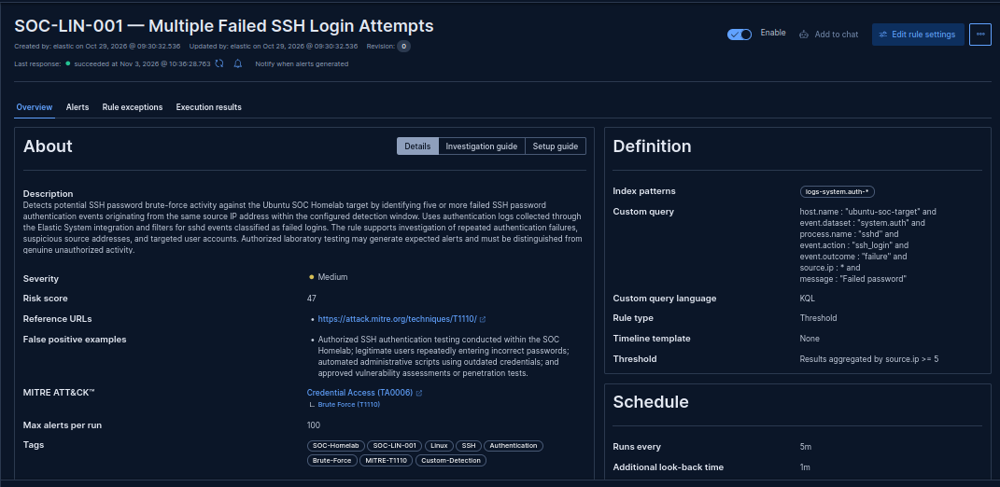
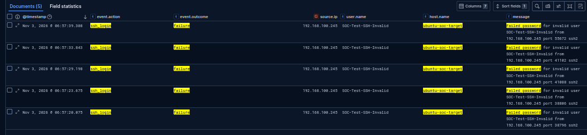
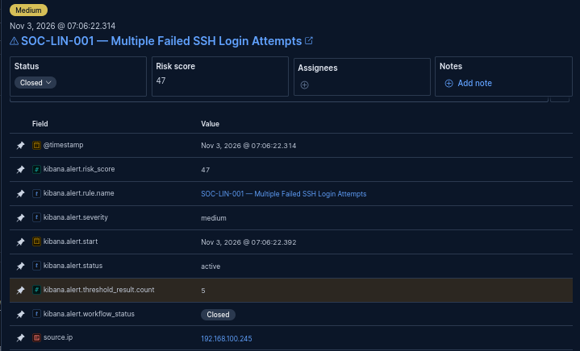
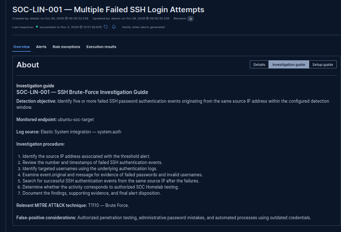

# SOC-LIN-001 — SSH Brute-Force Detection Investigation

## 1. Executive Summary

**Investigation Date:** 2026-11-03

**Detection Rule:** SOC-LIN-001 — Multiple Failed SSH Login Attempts

**Detection Objective:** Identify five or more failed SSH password authentication events originating from the same source IP address within the configured detection window.

**Investigation Classification:** True Positive — Benign

**Alert Disposition:** Closed

**Investigation Status:** Completed

The Elastic Security detection rule successfully identified five failed SSH password authentication attempts originating from the Kali Linux testing machine.

The activity was intentionally generated within the authorized SOC Homelab to validate the detection logic.

The alert was investigated and closed after confirming that the activity originated from authorized laboratory testing.

No unauthorized access was established during this investigation.

---

## 2. Laboratory Environment

| Component | Configuration |
|---|---|
| SIEM Platform | Elastic Security 9.5.5 |
| Elasticsearch | 9.5.5 |
| Target Host | ubuntu-soc-target |
| Target Operating System | Ubuntu Server 24.04.5 LTS |
| Target IP Address | 192.168.100.226 |
| Source Host | kali-linux |
| Source IP Address | 192.168.100.245 |
| Monitored Service | OpenSSH Server |
| Authentication Log | /var/log/auth.log |
| Elastic Data Stream | logs-system.auth-default |
| Fleet Policy | linux-soc-policy |
| Integration | linux-system-monitoring |

---

## 3. Detection Rule Configuration

| Parameter | Configuration |
|---|---|
| Rule ID | SOC-LIN-001 |
| Rule Name | Multiple Failed SSH Login Attempts |
| Rule Type | Threshold |
| Index Pattern | logs-system.auth-* |
| Threshold | 5 matching events |
| Group By | source.ip |
| Execution Interval | 5 minutes |
| Additional Look-back | 1 minute |
| Severity | Medium |
| Risk Score | 47 |
| MITRE ATT&CK Tactic | Credential Access (TA0006) |
| MITRE ATT&CK Technique | Brute Force (T1110) |
| Rule Status | Enabled |

### 3.1 Detection Query

```kql
host.name : "ubuntu-soc-target" and
event.dataset : "system.auth" and
process.name : "sshd" and
event.action : "ssh_login" and
event.outcome : "failure" and
source.ip : * and
message : "Failed password"
```

### 3.2 Detection Logic

The rule evaluates failed SSH password authentication events and groups matching events by their originating source IP address.

An alert is generated when at least five matching events are detected within the rule's configured query window.

This approach identifies repeated SSH authentication failures originating from a common source.

---

## 4. Controlled Test Procedure

The detection was validated through authorized SSH authentication testing.

### 4.1 Test Source

- Host: kali-linux
- IP Address: 192.168.100.245

### 4.2 Test Target

- Host: ubuntu-soc-target
- IP Address: 192.168.100.226
- Service: SSH
- Port: TCP/22

### 4.3 Test Username

SOC-Test-SSH-Invalid

### 4.4 Test Command

```bash
for i in {1..5}; do
    echo "===== SOC-LIN-001 Test Attempt $i/5 ====="

    ssh -o PubkeyAuthentication=no \
        -o PreferredAuthentications=password \
        -o NumberOfPasswordPrompts=1 \
        -o ConnectTimeout=5 \
        SOC-Test-SSH-Invalid@192.168.100.226

    echo
done
```

Five incorrect disposable passwords were submitted during the test.

Each authentication attempt was rejected.

The test was performed exclusively against the authorized Ubuntu SOC target.

---

## 5. Authentication Event Timeline

The following matching events were observed in Kibana Discover on November 3, 2026.

Timestamps are presented as displayed in the Kibana interface.

| Event | Timestamp | Source IP | Result |
|---|---|---|---|
| Earlier independent test | 06:49:10.951 | 192.168.100.245 | Failed |
| Test attempt 1 | 06:57:20.075 | 192.168.100.245 | Failed |
| Test attempt 2 | 06:57:23.675 | 192.168.100.245 | Failed |
| Test attempt 3 | 06:57:29.198 | 192.168.100.245 | Failed |
| Test attempt 4 | 06:57:33.843 | 192.168.100.245 | Failed |
| Test attempt 5 | 06:57:39.308 | 192.168.100.245 | Failed |

### 5.1 Observations

The five consecutive test failures occurred within approximately 19.233 seconds.

All five events originated from the same source IP address.

The deliberately invalid username was consistent across the test attempts.

The earlier independent authentication failure was outside the five-attempt test sequence.

---

## 6. Alert Evidence

Elastic Security generated a threshold detection alert with the following observed properties.

| Field | Value |
|---|---|
| Rule | SOC-LIN-001 — Multiple Failed SSH Login Attempts |
| Alert Timestamp | 2026-11-03 07:06:22.314 |
| Severity | Medium |
| Risk Score | 47 |
| Threshold Result Count | 5 |
| Source IP | 192.168.100.245 |
| Final Alert Status | Closed |

### 6.1 Threshold Verification

The alert contained the following field:

```text
kibana.alert.threshold_result.count: 5
```

This confirmed that the rule aggregated five matching authentication events.

### 6.2 Source Attribution

The alert identified:

```text
source.ip: 192.168.100.245
```

This matched the Kali Linux testing machine.

The source-IP aggregation therefore operated as intended during the controlled test.

---

## 7. Investigation Findings

### Finding 1 — SSH Authentication Failures Confirmed

The Ubuntu target rejected all five controlled authentication attempts.

The corresponding authentication failures were observed in Kibana Discover.

### Finding 2 — Telemetry Pipeline Validated

The test demonstrated that SSH authentication events were successfully collected and indexed through the configured Elastic monitoring pipeline.

### Finding 3 — Detection Logic Validated

The rule generated an alert after five matching failed SSH authentication events originated from the same source IP.

### Finding 4 — Threshold Aggregation Validated

The generated alert contained a threshold result count of five.

### Finding 5 — Source Attribution Validated

The source IP in the alert matched the authorized Kali Linux testing host.

### Finding 6 — Authorized Activity Confirmed

The observed authentication failures were intentionally generated as part of the SOC Homelab validation exercise.

The alert represented correctly detected test activity rather than an established unauthorized attack.

---

## 8. Detection Timing Observation

The fifth failed authentication event was recorded at approximately:

06:57:39.308

The generated alert was timestamped:

07:06:22.314

The observed difference between these timestamps was approximately:

8 minutes and 43.006 seconds

The detection rule was configured to execute every five minutes with an additional one-minute look-back.

The timing difference was documented but was not investigated further.

No definitive cause was established.

The successful detection and threshold aggregation were sufficient for the current functional validation objective.

---

## 9. False-Positive Assessment

The following legitimate activities may generate similar alerts:

- Authorized penetration testing.
- Repeated password-entry mistakes.
- Administrative authentication testing.
- Automated scripts using outdated credentials.
- Approved security assessments.

For the current investigation, the authentication failures were generated through an authorized laboratory test.

The activity was therefore classified as:

**True Positive — Benign**

This classification means that the detection correctly identified the targeted behavior, but the behavior occurred during authorized testing.

---

## 10. Limitations

The validation had the following limitations:

1. Only one originating source IP was tested.
2. The test used one deliberately invalid username.
3. No distributed authentication attack was simulated.
4. No confirmed unauthorized account compromise occurred.
5. Detection latency was observed but not investigated further.
6. Production-scale performance was not evaluated.
7. The rule was validated against the current laboratory telemetry and configuration.

These limitations should be considered before adapting the rule to a production environment.

---

## 11. Final Investigation Conclusion

**Detection Result:** Successful

**Alert Classification:** True Positive — Benign

**Alert Disposition:** Closed

**Investigation Status:** Completed

SOC-LIN-001 successfully detected five failed SSH password authentication attempts originating from the same source IP address.

The alert contained the expected threshold count, severity, risk score, and source attribution.

The investigation established that the activity originated from authorized Kali Linux testing within the SOC Homelab.

The rule achieved its primary functional detection objective and remains enabled for future monitoring and validation.

---

## 12. Future Improvements

- Develop an equivalent Sigma detection rule.
- Validate the rule against multiple targeted usernames.
- Test repeated authentication failures followed by successful SSH authentication.
- Evaluate duplicate-alert behavior.
- Test additional authorized attack scenarios.
- Review detection scheduling performance if future operational requirements justify it.
- Preserve supporting screenshots and relevant sanitized authentication events.
- Maintain the detection rule and investigation playbook under version control.

---

## 13. References

MITRE ATT&CK — Brute Force (T1110):

https://attack.mitre.org/techniques/T1110/

Elastic Security:

https://www.elastic.co/docs/solutions/security

---

**Project:** Elastic SOC Homelab

**Investigation ID:** SOC-LIN-001

**Documentation Status:** Completed

**Next Engineering Deliverable:** SOC-LIN-001 Sigma Detection Rule

---

## 14. Supporting Screenshot Evidence

The following screenshots provide supporting evidence for the SOC-LIN-001 detection and investigation.

### E01 — Detection Rule Overview



**Evidence:** Confirms the detection rule is enabled and displays its detection query, threshold configuration, severity, risk score, MITRE ATT&CK mapping, and execution schedule.

### E02 — Failed SSH Authentication Events



**Evidence:** Shows five failed SSH password authentication events originating from 192.168.100.245 against ubuntu-soc-target.

### E03 — Threshold Detection Alert



**Evidence:** Confirms the generated Medium-severity alert, risk score 47, source IP 192.168.100.245, threshold count of five, and Closed workflow status.

### E04 — Investigation Playbook



**Evidence:** Demonstrates the embedded SOC investigation procedure, including source attribution, authentication-event review, correlation, false-positive assessment, and alert disposition.

### Evidence Handling

Screenshots were captured from the authorized SOC Homelab environment.

No passwords, API keys, enrollment tokens, or private keys are intentionally included.

The evidence should be reviewed for sensitive information before publication to the public GitHub repository.
