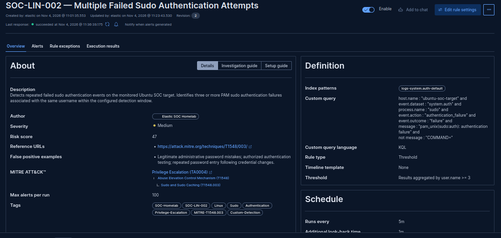
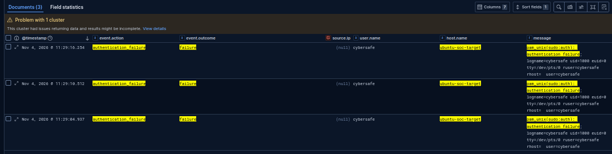
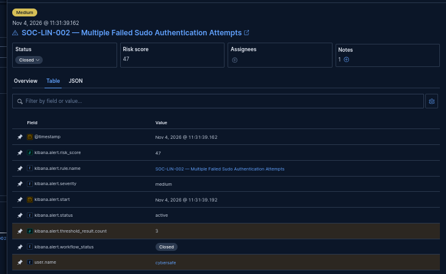
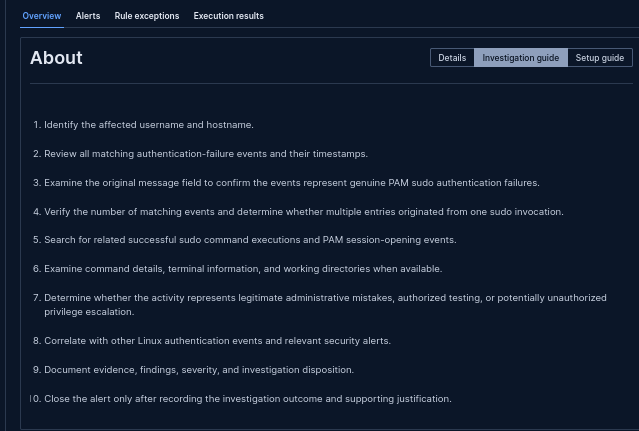

# SOC-LIN-002 — Failed Sudo Authentication Investigation

## 1. Executive Summary

**Investigation Date:** 2026-11-04

**Detection Rule:** SOC-LIN-002 — Multiple Failed Sudo Authentication Attempts

**Detection Objective:** Identify three or more genuine sudo PAM authentication-failure events associated with the same username within the configured detection window.

**Investigation Classification:** True Positive — Benign

**Alert Disposition:** Closed

**Investigation Status:** Completed

Elastic Security successfully detected three failed sudo authentication events generated during controlled testing on the Ubuntu SOC target.

The detection rule generated a Medium-severity threshold alert with a risk score of 47.

The alert correctly identified the affected account as `cybersafe` and reported a threshold count of three.

The activity was authorized laboratory testing.

The test did not demonstrate successful privilege escalation.

---

## 2. Laboratory Environment

| Component | Configuration |
|---|---|
| SIEM Platform | Elastic Security |
| Elasticsearch | 9.5.5 |
| Target Host | ubuntu-soc-target |
| Target Operating System | Ubuntu Server 24.04.5 LTS |
| Target IP Address | 192.168.100.226 |
| Operating System Account | cybersafe |
| Authentication Mechanism | PAM / sudo |
| Authentication Log | /var/log/auth.log |
| Elastic Data Stream | logs-system.auth-default |
| Fleet Policy | linux-soc-policy |
| Integration | linux-system-monitoring |
| Detection Type | Threshold |

---

## 3. Detection Rule Configuration

| Parameter | Configuration |
|---|---|
| Rule ID | SOC-LIN-002 |
| Rule Name | Multiple Failed Sudo Authentication Attempts |
| Rule Type | Threshold |
| Index Pattern | logs-system.auth-default |
| Threshold | 3 matching events |
| Group By | user.name |
| Execution Interval | 5 minutes |
| Additional Look-back | 1 minute |
| Severity | Medium |
| Risk Score | 47 |
| MITRE ATT&CK Tactic | Privilege Escalation (TA0004) |
| MITRE ATT&CK Technique | Abuse Elevation Control Mechanism (T1548) |
| MITRE ATT&CK Sub-technique | Sudo and Sudo Caching (T1548.003) |
| Rule Status | Enabled |

### 3.1 Detection Query

```kql
host.name : "ubuntu-soc-target" and
event.dataset : "system.auth" and
process.name : "sudo" and
event.action : "authentication_failure" and
event.outcome : "failure" and
message : "pam_unix(sudo:auth): authentication failure" and
not message : "COMMAND="
```

### 3.2 Detection Logic

The rule identifies genuine PAM sudo authentication-failure events collected from the monitored Ubuntu system.

It excludes sudo command-invocation records containing `COMMAND=`.

Matching events are grouped by `user.name`.

An alert is generated when the threshold of three matching events is reached within the rule's effective query window.

The rule counts authentication-failure log records, not necessarily individual password submissions or distinct sudo command executions.

### 3.3 Query Refinement

Initial investigation identified an important false-positive condition.

A legitimate administrative command used to search `/var/log/auth.log` contained the words `authentication failure` in its command arguments.

Elastic classified the corresponding event with:

- `event.action: authentication_failure`
- `event.outcome: failure`

Consequently, relying exclusively on these structured fields could produce misleading results.

The detection query was refined to require the genuine PAM sudo authentication-failure message and exclude records containing `COMMAND=`.

The revised query successfully isolated the genuine authentication failures during laboratory testing.

This filtering approach remains specific to the observed log format and requires additional validation before production deployment.

---

## 4. Controlled Testing Procedure

Testing was performed on the authorized Ubuntu SOC target.

### 4.1 Test Objective

Generate repeated failed sudo authentication events without intentionally executing a privileged command.

### 4.2 Test Procedure

The following commands were used during controlled testing:

```bash
sudo -k

for i in 1 2 3; do
    echo "===== SOC-LIN-002 Test $i/3 ====="
    sudo -k
    sudo -p "SOC-LIN-002 test password: " -v
done
```

Intentionally incorrect passwords were submitted.

Testing was restricted to the authorized laboratory environment.

### 4.3 Authentication Failure Verification

The following log pattern was confirmed:

```text
pam_unix(sudo:auth): authentication failure
```

The sudo authentication logs also demonstrated that one invocation may produce multiple authentication-related records.

Therefore, log-event counts must not automatically be interpreted as counts of independent sudo command executions.

---

## 5. Authentication Event Timeline

The following three matching events were observed in Kibana Discover on November 4, 2026.

Timestamps are presented as displayed in the Kibana interface.

| Event | Timestamp | Account | Result |
|---|---|---|---|
| Test event 1 | 11:29:04.937 | cybersafe | Failed |
| Test event 2 | 11:29:10.512 | cybersafe | Failed |
| Test event 3 | 11:29:16.254 | cybersafe | Failed |

### 5.1 Observations

Three matching authentication-failure records were generated within approximately 11.317 seconds.

All three events were associated with the same username.

The events originated from the monitored Ubuntu SOC target.

The matching records contained the expected PAM authentication-failure message.

The absence of a populated `source.ip` is consistent with the local nature of the sudo authentication test.

---

## 6. Alert Evidence

Elastic Security generated a threshold alert with the following observed properties.

| Field | Value |
|---|---|
| Rule | SOC-LIN-002 — Multiple Failed Sudo Authentication Attempts |
| Alert Timestamp | 2026-11-04 11:31:39.162 |
| Severity | Medium |
| Risk Score | 47 |
| Threshold Result Count | 3 |
| Associated Username | cybersafe |
| Final Workflow Status | Closed |

### 6.1 Threshold Verification

The alert contained:

```text
kibana.alert.threshold_result.count: 3
```

This confirms that the detection rule aggregated three matching authentication-failure events.

### 6.2 Username Attribution

The alert identified the account associated with the repeated authentication failures:

```text
user.name: cybersafe
```

The observed username matched the account used during the controlled test.

### 6.3 Alert Status

The investigation was completed and the alert workflow status was changed to Closed.

The alert's underlying active status and investigation workflow status are separate concepts in Elastic Security.

---

## 7. Detection Timing Observation

The final matching authentication-failure event occurred at:

11:29:16.254

The generated alert was timestamped:

11:31:39.162

The observed difference was approximately:

2 minutes and 22.908 seconds.

The rule was configured to execute every five minutes with an additional one-minute look-back.

This timestamp difference was documented as an observation.

It was not independently established as processing latency, and no definitive cause was assigned.

---

## 8. Investigation Findings

### Finding 1 — Genuine Sudo Authentication Failures Confirmed

The original authentication log contained genuine PAM sudo authentication-failure records.

### Finding 2 — Elastic Telemetry Pipeline Validated

The System integration successfully collected and indexed sudo authentication events from the Ubuntu target.

### Finding 3 — False-Positive Condition Identified

An administrative grep command initially matched authentication-related search terms.

The detection query was refined to exclude this observed false-match pattern.

### Finding 4 — Threshold Aggregation Validated

Three matching authentication-failure events satisfied the configured threshold.

Elastic Security generated the expected alert.

### Finding 5 — Username Attribution Validated

The alert correctly identified the account associated with the authentication failures.

### Finding 6 — Authorized Laboratory Activity Confirmed

The authentication failures were intentionally generated during controlled SOC Homelab testing.

There was no demonstrated successful privilege escalation during the test.

---

## 9. Alert Classification and Disposition

**Classification:** True Positive — Benign

**Disposition:** Closed

**Reason:** Authorized SOC Homelab detection testing.

The detection correctly identified the targeted authentication-failure behavior.

However, the observed activity was authorized and did not establish malicious privilege escalation.

An investigation note was recorded in Elastic Security before closure.

The detection rule remains enabled.

---

## 10. Detection Limitations

The following limitations apply:

1. The rule was validated against a single Ubuntu host.
2. Testing involved one operating system account.
3. The threshold counts matching log records, not distinct password submissions.
4. The query relies partly on message content specific to the observed PAM sudo logging format.
5. The `COMMAND=` exclusion does not guarantee elimination of every possible false positive.
6. Successful privilege escalation was not demonstrated.
7. Multi-host detection behavior was not tested.
8. Alert duplication across overlapping rule execution windows was not evaluated.
9. Production-scale detection performance was not evaluated.
10. Sigma-to-Elasticsearch backend equivalence was not independently tested.

These limitations must be considered before adapting the rule for production use.

---

## 11. Sigma Rule Validation

A portable Sigma representation was created:

`detection-rules/SOC-LIN-002.yml`

The YAML file contains two Sigma documents:

1. A base SigmaRule identifying genuine sudo PAM authentication failures.
2. A SigmaCorrelationRule identifying three or more matching events grouped by username within six minutes.

The file was successfully parsed using pySigma.

Validation output:

```text
Rules parsed: 2
SigmaRule - Linux Sudo PAM Authentication Failure
SigmaCorrelationRule - SOC-LIN-002 - Multiple Failed Sudo Authentication Attempts
```

Structural parsing was successful.

The Sigma rule was not independently converted to an Elasticsearch backend query or tested for runtime equivalence.

The tested native Elastic Security detection remains the authoritative functional implementation for this laboratory exercise.

---

## 12. Elasticsearch Health Observation

During evidence review, Kibana Discover displayed a cluster-related warning.

A subsequent Elasticsearch cluster-health check returned:

| Parameter | Observed Value |
|---|---|
| Cluster Status | Yellow |
| Number of Nodes | 1 |
| Active Primary Shards | 97 |
| Unassigned Primary Shards | 0 |
| Unassigned Shards | 25 |
| Pending Tasks | 0 |

The cluster remained operational.

All primary shards were assigned.

In a single-node Elasticsearch deployment, unassigned replica shards may explain a yellow health status.

However, the allocation reasons for the 25 unassigned shards were not independently verified.

The cluster-health response did not establish the cause of the earlier Kibana warning.

The detection rule had already generated its expected alert successfully.

A separate CA certificate loading error was also encountered during diagnostics. A temporary TLS-verification bypass was used for the cluster-health request only; it is not an approved permanent configuration.

---

## 13. Final Investigation Conclusion

**Detection Result:** Successful

**Threshold Aggregation:** Successful

**Username Attribution:** Successful

**Classification:** True Positive — Benign

**Alert Disposition:** Closed

**Investigation Status:** Completed

SOC-LIN-002 successfully detected three genuine failed sudo authentication events associated with the same username.

The generated alert contained the expected threshold count, severity, risk score, and username attribution.

The investigation determined that the activity originated from authorized testing.

The rule achieved its initial functional detection objective and remains enabled.

---

## 14. Future Improvements

- Test multiple affected usernames.
- Evaluate duplicate-alert behavior.
- Test multi-host authentication-failure aggregation.
- Evaluate successful sudo execution following repeated authentication failures.
- Develop separate detection logic for unauthorized sudo command execution.
- Evaluate production-relevant threshold values.
- Test Sigma backend conversion and runtime equivalence.
- Review and resolve the certificate-loading diagnostic issue separately.
- Investigate recurring Kibana search warnings if they affect detection or investigation.

---

## 15. Supporting Screenshot Evidence

### E01 — Detection Rule Overview



**Evidence:** Confirms the detection configuration, severity, threshold, MITRE ATT&CK mapping, and successful rule execution.

### E02 — Failed Sudo Authentication Events



**Evidence:** Demonstrates three genuine failed PAM sudo authentication events associated with the monitored user.

The screenshot contains a Kibana cluster warning, which is documented separately in this report.

### E03 — Threshold Detection Alert



**Evidence:** Confirms the generated threshold alert, severity, risk score, username attribution, threshold count, and closed workflow status.

### E04 — Investigation Playbook



**Evidence:** Demonstrates the embedded investigation procedure, including authentication analysis, related activity correlation, false-positive assessment, and alert disposition.

---

## 16. References

MITRE ATT&CK — Sudo and Sudo Caching (T1548.003):

https://attack.mitre.org/techniques/T1548/003/

Elastic Security:

https://www.elastic.co/docs/solutions/security

---

**Project:** Elastic SOC Homelab

**Investigation ID:** SOC-LIN-002

**Documentation Status:** Completed

**Sigma Validation:** Structural parsing passed

**Native Elastic Detection:** Functionally validated
