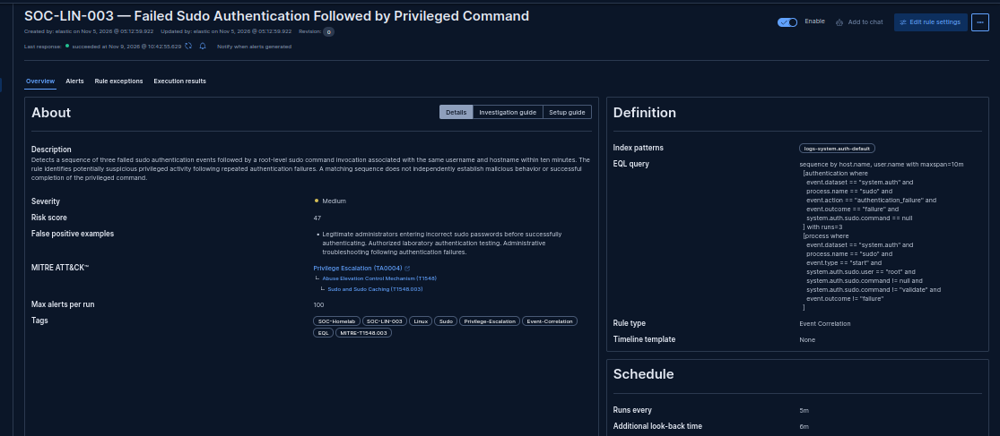
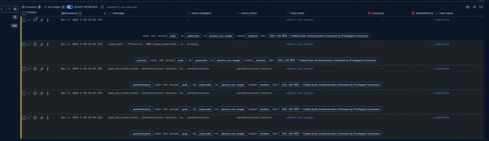
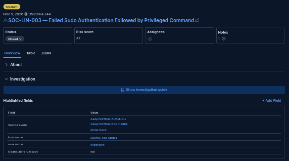
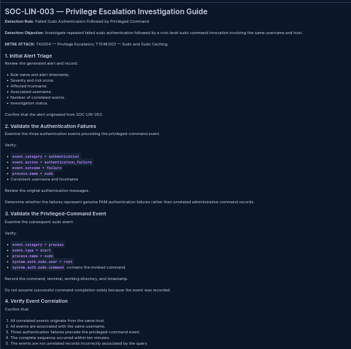
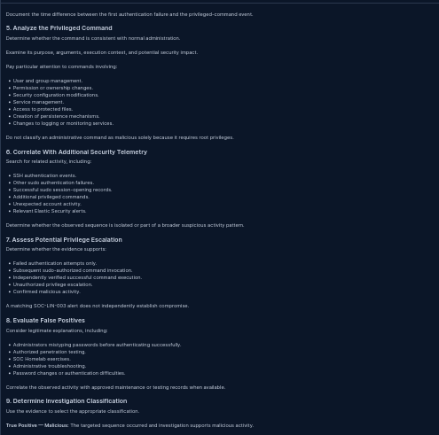
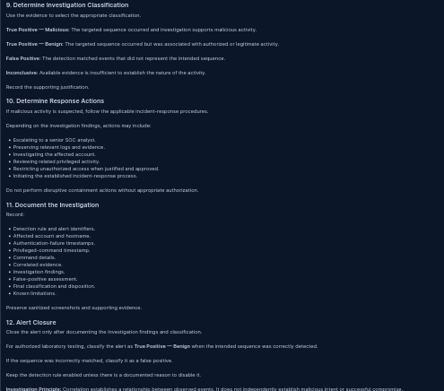

# SOC-LIN-003 — Failed Sudo Authentication Followed by Privileged Command

## 1. Executive Summary

**Investigation Date:** November 5, 2026

**Rule ID:** SOC-LIN-003

**Rule Name:** Failed Sudo Authentication Followed by Privileged Command

**Detection Type:** Event Correlation (EQL)

**Classification:** True Positive — Benign

**Alert Disposition:** Closed

**Investigation Status:** Completed

SOC-LIN-003 successfully identified an ordered sequence of three failed sudo authentication events followed by a root-level sudo command invocation.

Elastic Security correlated the events using their common hostname and username.

The activity was deliberately generated during authorized SOC Homelab testing.

The subsequent `/usr/bin/id -u` command independently returned effective UID 0, confirming that the controlled privileged-command test executed with root privileges.

No malicious activity or unauthorized privilege escalation was established.

---

## 2. Laboratory Environment

| Component | Configuration |
|---|---|
| SIEM | Elastic Security |
| Elasticsearch | 9.5.5 |
| Target hostname | ubuntu-soc-target |
| Target operating system | Ubuntu Server 24.04.5 LTS |
| Target IP | 192.168.100.226 |
| Test account | cybersafe |
| Authentication mechanism | PAM / sudo |
| Authentication log | /var/log/auth.log |
| Elastic integration | System |
| Dataset | system.auth |
| Data stream | logs-system.auth-default |
| Detection type | EQL Event Correlation |

---

## 3. Detection Rule Configuration

| Parameter | Value |
|---|---|
| Rule ID | SOC-LIN-003 |
| Rule type | Event Correlation |
| Query language | EQL |
| Index pattern | logs-system.auth-default |
| Correlation fields | host.name, user.name |
| Failed authentication events | 3 |
| Subsequent event | Root-level sudo command invocation |
| Maximum sequence span | 10 minutes |
| Execution interval | 5 minutes |
| Additional look-back | 6 minutes |
| Severity | Medium |
| Risk score | 47 |
| MITRE ATT&CK tactic | Privilege Escalation (TA0004) |
| MITRE ATT&CK technique | Abuse Elevation Control Mechanism (T1548) |
| MITRE ATT&CK sub-technique | Sudo and Sudo Caching (T1548.003) |
| Rule status | Enabled |

### 3.1 Native EQL Detection Query

```eql
sequence by host.name, user.name with maxspan=10m
  [authentication where
    event.dataset == "system.auth" and
    process.name == "sudo" and
    event.action == "authentication_failure" and
    event.outcome == "failure" and
    system.auth.sudo.command == null
  ] with runs=3
  [process where
    event.dataset == "system.auth" and
    process.name == "sudo" and
    event.type == "start" and
    system.auth.sudo.user == "root" and
    system.auth.sudo.command != null and
    system.auth.sudo.command != "validate" and
    event.outcome != "failure"
  ]
```

### 3.2 Detection Logic

The rule requires three authentication-failure events followed by one sudo process-start event.

All events must share the same host.name and user.name.

The events must appear in the required order within ten minutes.

This differs from a threshold rule, which counts matching events without necessarily enforcing the intended event sequence.

### 3.3 Query Engineering

An initial EQL query attempted wildcard searches against the message field.

Elasticsearch rejected these expressions because message was mapped as text without a keyword-compatible field for the requested operation.

The query was revised to use structured ECS and System integration fields.

The revised EQL was accepted by Kibana.

The authentication-stage selection was compared with seven previously identified sudo authentication-failure records.

The process-stage selection was compared with four existing sudo command-invocation records.

Both stages passed initial validation against the available laboratory telemetry.

---

## 4. Controlled Validation Procedure

### 4.1 Test Objective

Generate repeated failed sudo authentication events followed by a harmless root-level sudo command invocation on the same host and account.

### 4.2 Failed Authentication Phase

The following procedure was used:

```bash
sudo -k

for i in 1 2 3; do
    echo "===== SOC-LIN-003 Failed Authentication $i/3 ====="
    sudo -k
    sudo -p "SOC-LIN-003 incorrect password: " -v
done
```

Intentionally incorrect passwords were entered during the controlled test.

The actual number of matching authentication log records was verified through Elastic telemetry.

### 4.3 Privileged Command Phase

Following the authentication failures, the operator executed:

```bash
sudo -k
sudo /usr/bin/id -u
```

The command returned:

```text
0
```

This independently confirmed that the test command executed with effective UID 0.

The test was performed within the authorized Ubuntu SOC Homelab.

---

## 5. Correlated Event Timeline

The following events were observed in the Elastic Security Timeline.

Timestamps are shown as displayed in Kibana on November 5, 2026.

| Sequence | Timestamp | Event |
|---|---|---|
| 1 | 05:23:04.226 | Failed sudo authentication |
| 2 | 05:23:04.292 | Failed sudo authentication |
| 3 | 05:23:04.303 | Failed sudo authentication |
| 4 | 05:23:04.310 | Sudo process event |
| Alert | 05:23:04.344 | SOC-LIN-003 correlation alert |

### 5.1 Timestamp Observation

The Timeline overview displays the final process event at 05:23:04.310.

A separately examined expanded Timeline entry displayed approximately 05:23:04.318.

The eight-millisecond discrepancy was observed in the screenshots but was not independently reconciled.

The displayed timestamps indicate that the matched events occurred in rapid succession.

The exact source-event timestamp representation should be verified before using these values for detailed latency measurements.

### 5.2 Correlation Findings

The Timeline confirmed:

- Three authentication-failure events.
- One subsequent sudo process event.
- The same username across the correlated events.
- The same hostname across the correlated events.
- Correct event ordering.
- A sequence within the configured ten-minute maximum span.

---

## 6. Generated Alert Evidence

| Field | Observed Value |
|---|---|
| Rule | SOC-LIN-003 |
| Alert timestamp | 2026-11-05 05:23:04.344 |
| Severity | Medium |
| Risk score | 47 |
| Host | ubuntu-soc-target |
| Username | cybersafe |
| Rule category | Event Correlation Rule |
| Final workflow status | Closed |

Elastic Security generated the alert after the controlled correlation test.

The investigation used the Elastic Security Timeline and associated source-event references.

Unlike a threshold alert, the EQL sequence alert must be evaluated through its correlated event sequence rather than relying on kibana.alert.threshold_result.count.

---

## 7. Investigation Findings

### Finding 1 — Failed Authentication Confirmed

Three sudo authentication-failure events were identified in the correlated sequence.

### Finding 2 — Privileged Command Activity Confirmed

A subsequent sudo command-invocation record identified:

```text
USER=root
COMMAND=/usr/bin/id -u
```

The operator independently verified successful execution through an effective UID result of 0.

### Finding 3 — Event Ordering Validated

The authentication failures preceded the sudo command event.

### Finding 4 — Correlation Fields Validated

The sequence was associated with:

```text
host.name: ubuntu-soc-target
user.name: cybersafe
```

### Finding 5 — EQL Alert Generation Validated

Elastic Security generated a Medium-severity event-correlation alert with risk score 47.

### Finding 6 — Authorized Activity Confirmed

The sequence originated from an approved SOC Homelab test.

No unauthorized privilege escalation was established.

---

## 8. Alert Classification and Disposition

**Detection Result:** Successful

**Classification:** True Positive — Benign

**Disposition:** Closed

**Reason:** Authorized laboratory testing.

The detection correctly identified the intended sequence.

The observed behavior was authorized and did not establish malicious intent.

An investigation note was recorded before closure.

The detection rule remains enabled.

---

## 9. Detection Limitations

1. The rule was validated against one Ubuntu host.
2. The controlled test involved one username.
3. Three authentication-failure log records do not necessarily represent three independent sudo invocations.
4. A sudo process-start record does not independently prove successful completion of every command.
5. The query does not establish malicious intent.
6. Other legitimate administrative activities may produce the same sequence.
7. Duplicate-alert behavior across overlapping execution windows was not evaluated.
8. Multi-host detection behavior was not tested.
9. Production-scale performance was not evaluated.
10. Detection accuracy depends on the available Elastic System integration fields.
11. The native EQL query is the validated implementation; equivalent Sigma sequence behavior has not been established.
12. The minor displayed timestamp discrepancy requires reconciliation before precise latency analysis.

---

## 10. Sigma Detection and Correlation Representation

A Sigma representation of SOC-LIN-003 was created:

`detection-rules/SOC-LIN-003.yml`

The file contains four Sigma documents:

| Document | Purpose |
|---|---|
| SigmaRule 1 | Identify failed sudo authentication events |
| SigmaRule 2 | Identify root-level sudo command invocations |
| SigmaCorrelationRule 1 | Detect at least three authentication failures associated with the same username and hostname |
| SigmaCorrelationRule 2 | Represent the intended ordered relationship between repeated failures and a subsequent privileged-command event |

### 10.1 Structural Validation

The complete Sigma file was parsed using pySigma.

Validation output:

```text
Rules parsed: 4
SigmaRule - Linux Sudo Authentication Failure for Sequence Correlation
SigmaRule - Linux Root-Level Sudo Command Invocation
SigmaCorrelationRule - SOC-LIN-003 - Repeated Sudo Authentication Failures
SigmaCorrelationRule - SOC-LIN-003 - Sudo Failures Followed by Root Command
```

All four documents passed structural parsing.

### 10.2 Correlation Limitations

The Sigma representation uses a chained event-count and temporal-ordered correlation.

It has not been independently translated into executable Elasticsearch detection logic.

Backend support for chained correlation rules has not been established.

The nested correlation windows may not enforce the same overall ten-minute limit as the native EQL sequence.

Therefore, structural validation does not establish equivalent detection behavior.

### 10.3 Authoritative Implementation

The native Elastic Security EQL rule remains the authoritative, functionally validated SOC-LIN-003 implementation.

The Sigma file is retained as an experimental portable representation.

Full functional equivalence must not be claimed until backend conversion and execution tests are completed.

---

## 11. Future Improvements

- Test additional usernames.
- Evaluate multi-host correlation behavior.
- Test alternative privileged commands.
- Investigate false-positive scenarios involving legitimate administrative activity.
- Evaluate detection latency using source-event and alert timestamps.
- Test overlapping-window duplicate alerts.
- Assess whether richer audit telemetry can establish command completion and exit status.
- Evaluate portable correlation formats and backend support.
- Develop additional privilege-escalation detection scenarios.

---

## 12. Supporting Screenshot Evidence

### E01 — Detection Rule Overview



**Evidence:** Shows the EQL query, correlation configuration, severity, risk score, ATT&CK mapping, and schedule.

### E02 — Correlated Event Sequence



**Evidence:** Shows three authentication failures followed by the sudo process event in Elastic Security Timeline.

### E03 — Correlation Alert



**Evidence:** Confirms the alert, hostname, username, severity, risk score, investigation note, and Closed workflow status.

### E04-A — Investigation Playbook, Part 1



### E04-B — Investigation Playbook, Part 2



### E04-C — Investigation Playbook, Part 3



**Evidence:** The three screenshots document the investigation procedure, event verification, correlation analysis, classification, response guidance, and alert closure process.

---

## 13. References

MITRE ATT&CK — Sudo and Sudo Caching (T1548.003):

https://attack.mitre.org/techniques/T1548/003/

Elastic Security:

https://www.elastic.co/docs/solutions/security

---

**Project:** Elastic SOC Homelab

**Investigation ID:** SOC-LIN-003

**Investigation Status:** Completed

**Native EQL Detection:** Functionally validated

**Sigma Equivalence:** Not established

**Documentation Status:** Completed
